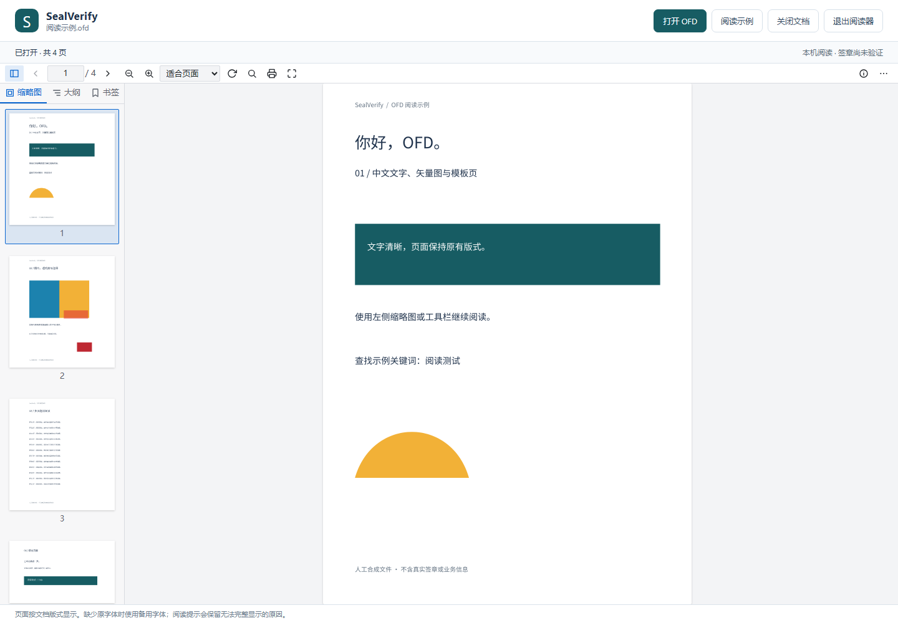

# SealVerify

基于 Python 开发的电子印章与电子签章验证工具，面向 OFD 等签章文件的解析、属性展示和完整验证，帮助使用者定位问题并判断验证结论。

> 当前版本：0.5.0。已提供本地 OFD 阅读器、版本 4 签章属性解析、第一步签章格式诊断及第二步印章格式检查。格式问题逐项记录，独立检查继续执行；无法自动确认的项目明确列出。密码验签、证书信任验证及独立安装包仍待实现。

项目仓库：[Loora1N/SealVerify](https://github.com/Loora1N/SealVerify)（公开）。

## 目录

- [项目目标](#项目目标)
- [标准与参考资料](#标准与参考资料)
- [功能需求](#功能需求)
- [验证结果约定](#验证结果约定)
- [使用方式](#使用方式)
- [项目结构](#项目结构)
- [开发路线](#开发路线)
- [开发与协作](#开发与协作)
- [许可证](#许可证)

## 项目目标

- 解析签章文件，分别展示电子印章和电子签章的属性、证书及验证结果。
- 打开 OFD，按页面版式阅读原文，将文档阅读作为后续签章检查的共同入口。
- 完整执行适用的检查；单项失败后继续其他检查，集中输出问题与上下文。
- 支持导入 CA 证书、信任锚和 CRL，为离线验证提供所需材料。
- 最终交付可供同事直接启动的工具。允许采用图形界面或命令行，打包后的普通使用者无需单独配置 Python 环境；具体界面与打包方案待确定。

## 标准与参考资料

- 核心依据：[GB/T 38540—2020《信息安全技术 安全电子签章密码技术规范》](https://openstd.samr.gov.cn/bzgk/std/newGbInfo?hcno=EBF1360C272E40E7A8B9B32ED0724AB1)。后续实现应记录检查项与具体条款的对应关系，并核对适用版本。
- 证书路径与 CRL 处理参考：[RFC 5280](https://www.rfc-editor.org/rfc/rfc5280.html)。CA 证书和信任锚用于证书路径验证，CRL 用于吊销状态检查，二者不能相互替代。
- OFD 阅读采用 [GB/T 33190—2016《电子文件存储与交换格式 版式文档》](https://openstd.samr.gov.cn/bzgk/std/newGbInfo?hcno=3AF6682D939116B6F5EED53D01A9DB5D) 对应的 OFDRW 渲染引擎。集成与兼容边界见 [阅读器说明](docs/ofd-reader.md)。后续签名引用解析仍需单独核对标准，不能把渲染结果当作签名保护范围。
- 本地 `材料/` 目录存放标准 PDF、学习笔记和配图，默认不纳入 Git。笔记用于辅助理解，出现差异时应核对标准原文，不直接将笔记中的结构或结论作为实现依据。

## 功能需求

以下分别标记已实现的阅读功能和待实现的验证功能。

### OFD 阅读（已实现）

- 本地选择或拖放 OFD，也可通过启动命令指定文件；自动打开浏览器阅读界面。
- 连续阅读全部页面，提供缩略图、上一页/下一页、跳页、缩放、旋转、大纲及文字查找/选择。
- 渲染文字、图片、矢量图、模板页和注释；内嵌字体优先，缺省字体使用随包附带的 Noto Sans CJK SC。
- 多文档 OFD 包显示文档选择框，逐份阅读；原始文件保持不变。
- 提供打印入口；损坏或不支持的内容显示阅读提示，独立页面继续阅读。
- 文件在本机处理，程序和字体资源随包分发，日常阅读无需联网。

加密 OFD 暂不支持；特殊扩展、罕见图像编码或缺失字体可能无法准确还原，不宣称对所有 OFD 变体完整符合标准。具体限制和排查方法见 [阅读器说明](docs/ofd-reader.md)。

### 签章解析与属性展示（已实现 M2b）

- 支持 OFD 的文档、签章清单、页面关联，以及 GB/T 38540—2020 版本 4 的签章结构；旧版和其他格式明确提示支持边界。
- 提取并区分文件中的电子签章及其内嵌电子印章；遇到多个签章时分别给出结果。
- 展示电子印章标识、版本、属性、图像、有效期、制章者证书、算法标识等可解析信息。
- 展示电子签章版本、声明时间、签章者证书、算法、原文杂凑、厂商声明的原文属性、文件引用清单及可选时间戳属性；尚未计算杂凑、确认完整保护范围或验证时间戳。
- 按各对象的签名算法展示签名值：SM2 拆分完整 r、s 十六进制，RSA 显示完整签名字节；分别标明电子签章签名、制章签名和证书颁发者签名。
- 对缺失、未知或损坏字段给出位置和原因，保留其他可用信息。
- 在阅读界面选择签章并定位到页面区域；多文档切换保持各自的签章关联。提供 `sealverify inspect` JSON 结构清单。

详见 [签章属性说明](docs/signature-inspection.md)。全部属性标记未验证；证书不因成功读取而成为可信证书或信任锚。

### 电子印章验证

| 检查项 | 目标行为 |
| --- | --- |
| 数据格式 | 已提供第二步独立格式检查：结构、编码、必填字段、图像可解码性及已覆盖约束 |
| 签名值 | 按适用标准确定待签名数据与算法，验证制章签名 |
| 制章者证书 | 检查证书可解析性、有效期、用途及适用约束，并分别报告证书路径和吊销状态 |
| 印章有效期 | 按适用验证场景检查有效期，并在报告中说明使用的时间基准 |

第二步已接入：分别诊断内嵌印章和 OFD 外置印章。某一处失败后继续独立资源与字段；无法读取、未声明及检查通过分别报告。详见 [电子印章格式说明](docs/seal-format.md)。制章签名、证书信任和有效期仍待实现。

### 电子签章验证

第一步已接入：打开文件后自动进行电子签章的格式诊断，按 GB/T 38540—2020 第 7.1 节检查支持的结构、类型、编码和约束。发现错误后继续检查其他独立字段及签章；前置数据不可读时标明跳过。界面显示问题位置、标准依据和复核建议，也可使用 `sealverify check-format` 输出全部结果。

厂商保护范围语义及引用标准的完整配置约束仍需复核，因此“未发现已检查项错误”不会显示为完整验证通过。工具覆盖不足单列为能力说明，不混入文件错误。检查覆盖与限制见 [数据格式诊断说明](docs/signature-format.md)。以下密码验证步骤逐步实现：

| 检查项 | 目标行为 |
| --- | --- |
| 数据格式 | 已提供支持范围内的逐项诊断；未覆盖范围单独列为能力说明，完整符合性尚未确认 |
| 签名值 | 验证签章者对相应待签名数据的签名 |
| 签章者与印章匹配 | 检查签章者证书与印章授权信息的匹配关系 |
| 内嵌印章 | 执行完整的电子印章验证流程并关联结果 |
| 签章者证书 | 检查证书有效性，分别报告证书路径和吊销状态 |
| 签章时间 | 按适用规则检查时间有效性，区分声明的签章时间和可信时间证据 |
| 原文杂凑 | 确认原文及签名保护范围，重新计算并比较杂凑值 |
| 时间戳 | 检查时间戳结构、签名、消息印记绑定及相关证书；缺失时按适用规则说明是否必需 |

### 证书与验证材料

- 支持用户导入中间 CA 证书、明确选定的信任锚和 CRL。导入证书不等于自动将其设为可信根。
- 缺少证书链或信任锚时，继续证书自身属性及其他可执行检查，明确提示“证书链未完成验证，需用户自行补充验证”。
- 缺少可用 CRL 时，不推断证书“未被吊销”；报告吊销状态无法确定。提供 CRL 后还需检查其签名、适用范围与时间有效性。
- 明确报告验证时间、时间来源与材料来源；不能仅凭不受信任的签章时间宣称历史时刻有效。

### 持续检查与问题报告

- 单项校验失败或发生可捕获异常时，记录结果并继续全部独立检查。
- 依赖字段无法解析时，为相应检查记录“跳过”及依赖原因；不得凭空计算结果，也不得静默省略。
- 正常流程的终止条件是全部检查项均已执行或明确说明不能执行的原因；即使输入无法解析，也应返回可读的失败报告。
- 每条结果至少包含：对象/签章标识、检查项、状态、问题描述、相关文件或字段位置、期望与实际值、可用的标准依据、建议的人工复核步骤。
- 输出尽可能充分且必要的上下文，便于识别误报；大段原文与二进制数据采用摘要或受控截断，报告避免泄露私钥、口令和无关个人信息。

## 验证结果约定

以下状态已用于数据格式诊断，接口和汇总规则见 [结果模型说明](docs/result-model.md)。密码验签与信任验证仍待实现；格式结果与完整验证结论分开处理。

| 状态 | 含义 |
| --- | --- |
| 通过 | 本检查已完成，证据支持满足相应要求 |
| 失败 | 本检查已完成，证据表明不满足相应要求 |
| 无法确定 | 已尝试检查，但材料、算法支持或可信时间等条件不足 |
| 跳过 | 前置条件不满足，无法执行；必须说明依赖原因 |
| 错误 | 执行过程发生异常，尚未形成业务判定 |
| 不适用 | 适用规则明确该项不要求检查，必须记录判断依据 |

整体结论必须与逐项结果一起呈现：存在失败项则报告失败；没有失败但必需检查中存在无法确定、跳过或错误时，报告验证不完整；只有所有适用的必需检查通过时，才可报告整体通过。可选字段缺失不能无条件判为失败或通过。

报告同时记录检查计划与实际结果。计划中的任一项未返回结果时，报告验证不完整；空计划、全部不适用或仅有可选检查也不能形成整体通过结论。可选项的异常会保留在明细中，即使整体必需检查通过也应复核明细。

## 使用方式

### 当前可用内容

完成下方首次安装后，在 Windows 双击根目录的 **`打开OFD阅读器.cmd`**，然后点击“打开 OFD”选择文件，也可以把文件拖入浏览器页面。点击“阅读示例”可体验内置四页合成文档。

关闭标签页不会结束本地服务；使用页面右上角“退出阅读器”，或在启动窗口按 Ctrl+C。命令行也可启动：

```powershell
.\.venv\Scripts\python.exe -m sealverify view
.\.venv\Scripts\python.exe -m sealverify view "C:\文档\示例.ofd"
.\.venv\Scripts\python.exe -m sealverify view --demo
```

使用当前 Chrome 或 Edge。暂未提供无需 Python 的独立安装程序；本机环境已经准备好时可直接双击启动。

打开含签章的文件后，右侧自动出现“签章信息”。选择签章，点击“定位第 N 页”查看黄色区域，再展开印章、签章者/制章者证书及文件引用。签名值卡片直接显示 SM2 的 r、s 或 RSA 的完整十六进制，不再显示 SHA-256 和截断预览。命令行可输出结构清单：

```powershell
.\.venv\Scripts\python.exe -m sealverify inspect "C:\文档\示例.ofd"
.\.venv\Scripts\python.exe -m sealverify check-format "C:\文档\示例.ofd"
.\.venv\Scripts\python.exe -m sealverify check-seal-format "C:\文档\示例.ofd"
.\.venv\Scripts\python.exe -m sealverify check-seal-format "C:\文档\Seal.esl" --seal
```



合成验证报告示例仍用于展示结果模型，没有执行真实密码验证；接口见 [结果模型说明](docs/result-model.md)。

### Python 开发环境

- 最低版本要求：Python 3.9，见 `pyproject.toml` 的 `requires-python`。
- 开发版本：Python 3.12，见 `.python-version`；本次实际验证使用 3.12.9。
- 环境目录：项目根目录 `.venv/`，不提交 Git。虚拟环境应在每台开发机器上重新创建。
- Python 解析依赖固定版本 `asn1crypto==1.5.1` 与 `defusedxml==0.7.1`，图像解码依赖 `Pillow>=11.3,<14`（pip 按 Python 版本选择兼容版本），构建后端为 setuptools。浏览器端使用随包分发的 OFDRW 0.1.7 与中文字体，普通使用者不需要 Node.js。首次安装会准备构建及运行依赖。
- GitHub Actions 配置了 Windows 上的 Python 3.9 与 3.12 测试；是否通过以对应提交的 Checks 为准。基础测试不等于真实签章业务已通过验收。

Windows PowerShell 下，在项目根目录执行（已存在 `.venv` 时直接使用，无需重复创建）：

```powershell
py -3.12 -m venv .venv
.\.venv\Scripts\python.exe --version
.\.venv\Scripts\python.exe -m pip --version
.\.venv\Scripts\python.exe -m pip check
```

后续安装依赖、运行程序或测试时，统一使用 `.\.venv\Scripts\python.exe` 和该解释器的 `-m pip`。显式调用虚拟环境解释器即可，无需激活脚本或修改 PowerShell 执行策略。环境机制参考 [Python venv 文档](https://docs.python.org/3.12/library/venv.html)。

### 安装、运行和测试

在项目根目录执行：

```powershell
.\.venv\Scripts\python.exe -m pip install -e .
.\.venv\Scripts\python.exe -m sealverify --help
.\.venv\Scripts\sealverify.exe --version
.\.venv\Scripts\python.exe examples/result_report.py
.\.venv\Scripts\python.exe -m unittest discover -s tests -v
```

版本输出为 `SealVerify 0.5.0`。合成报告的 `overall_status` 为 `incomplete`：即使示例签名项通过，缺少证书链材料也不能整体通过。阅读器运行与前端构建测试见 [阅读器说明](docs/ofd-reader.md)。

需要构建供开发者安装的 wheel 时执行：

```powershell
.\.venv\Scripts\python.exe -m pip wheel . --no-deps --wheel-dir dist
```

产物位于 `dist/`，该目录不纳入 Git。wheel 需要 Python 环境，不是最终面向同事分发的独立可执行程序。

### 阅读与验证流程

当前：打开工具 → 选择 OFD → 阅读页面、查找内容 → 选择签章 → 查看格式诊断、属性与页面位置（密码验签未执行）。

后续：按需导入证书链、信任锚和 CRL → 启动验证 → 将逐项问题定位到签章、页面和字段。验证报告导出格式在验证界面实现时确定。

## 项目结构

```text
SealVerify/
├── README.md                 # 项目说明、需求与路线
├── CONTRIBUTING.md           # 开发、验收与 PR 合并流程
├── .github/
│   ├── pull_request_template.md  # PR 交付说明模板
│   └── workflows/tests.yml   # Windows / Python 3.9、3.12 基础检查
├── pyproject.toml            # 项目元数据与 Python 最低版本
├── .python-version           # 选用的 Python 开发版本
├── .gitignore                # 本地材料、敏感配置及生成物排除规则
├── .gitattributes            # 文本换行约定
├── src/sealverify/           # 命令行、本地阅读服务、inspection 解析与结果模型
│   └── web/                 # 离线阅读资源、字体与合成 OFD
├── frontend/                # 阅读器源代码、锁定的依赖和浏览器测试
├── tests/                    # 汇总模型、服务边界与入口测试
├── examples/                # 合成验证报告、阅读及签章结构样例生成器
├── tools/                   # 本地基准回归入口（业务清单不提交）
├── 打开OFD阅读器.cmd          # Windows 双击启动入口
├── docs/
│   ├── result-model.md       # 数据契约与汇总规则
│   ├── ofd-reader.md         # 阅读操作、实现边界和资源重建
│   ├── signature-inspection.md # 签章操作、结构契约与标准依据
│   ├── signature-format.md   # 第一步签章格式诊断
│   ├── seal-format.md        # 第二步印章格式、覆盖范围与限额
│   └── devlogs/
│       ├── README.md         # 开发日志规范与索引
│       ├── TEMPLATE.md       # 单次任务日志模板
│       └── YYYY-MM-DD-NNN-topic.md
├── .venv/                    # 本地 Python 虚拟环境，不纳入 Git
└── 材料/                     # 仅本地保留的参考资料，可不存在于克隆目录
```

阅读界面、版本 4 属性解析及两步格式诊断已实现；密码验证器在后续阶段接入。

## 开发路线

- [x] M0：整理需求、协作约定和首篇日志，建立版本管理。
- [x] 环境准备：确定 Python >=3.9 的版本要求，使用 Python 3.12 创建本地 `.venv`。
- [x] M1：建立可安装基础包、命令行入口、结果模型、合成示例及测试/CI 入口；密码与解析依赖留待业务阶段选择。
- [x] M2a：提前实现 OFD 阅读入口、页面渲染和导航，为后续验证提供原文阅读界面。
- [x] M2b：实现签章结构解析、属性展示及其与阅读页面的关联，覆盖损坏输入与多签章场景。
- [ ] M3：实现电子印章、电子签章及原文杂凑验证。
  - 已提供电子签章格式诊断及内嵌/外置电子印章的独立格式检查；密码验签与杂凑重算尚未实现。
- [ ] M4：实现证书路径、CRL、签章时间和时间戳检查，完善不完整验证的报告。
- [ ] M5：整合阅读与验证界面、报告呈现、可分发安装包及端到端验收。

各阶段需具备相应的正常样例、失败样例及缺少材料的样例。路线是实施顺序建议，具体技术选型和验收范围在任务开始时确定。

## 开发与协作

采用“提出需求 → 任务分支开发与自检 → Pull Request → 维护者验收并合并”的流程。维护者可主要通过阅读 PR 的行为说明、验证证据和验收步骤参与，无需亲自编写代码。具体操作见 [协作指南](CONTRIBUTING.md)。

- 每个任务使用独立分支并提交 PR，维护者决定是否合并到 `main`；不默认启用自动合并。
- 开始任务前阅读本文件、最近的开发日志，以及本机已有的开发约定。
- 需求变更应同步更新 README；将计划能力与已经实现、验证的能力分开描述。
- 每次完成开发任务后，创建一篇独立日志并更新日志索引，记录修改文件、验证结果、限制与后续事项。
- 功能或缺陷修改应执行与改动相关的验证；未执行的检查必须说明原因。
- 仅提交与任务相关的文件。本地助手指令、提示词、`.venv/`、`材料/`、私钥、真实业务文件、运行报告、缓存和构建产物保留在本地；可分享的测试数据应使用脱敏或合成样例。
- 提交信息建议使用 `docs:`、`feat:`、`fix:`、`test:` 或 `chore:` 前缀。

## 许可证

项目自身尚未选定开源许可证。附带的第三方阅读组件、运行依赖和字体分别保留其授权声明，见 [第三方资源说明](docs/third-party.md)。第三方授权不会自动改变本项目自身的许可证。
