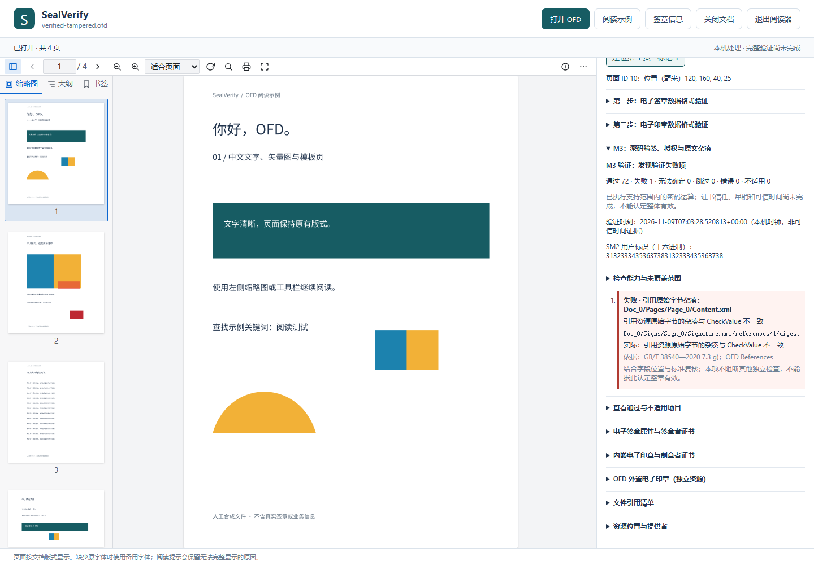

# M3：密码验签、授权与原文杂凑

0.6.0 新增 OFD 验证入口。打开文件后先显示原有格式检查和属性，点击右侧 **执行 M3 验证**，再查看“M3：密码验签、授权与原文杂凑”。选择其他签章可查看各自结果，阅读与定位继续可用。切换文件会丢弃旧文件的迟到响应；服务失败可重试。

M3 完成的是下表中的计算与一致性检查。即使这些项目全部通过，证书信任、吊销和可信时间仍未验证，不能据此认定整体有效。明细优先列出失败、无法确定、跳过和检查器错误。

## 检查与依据

已核对 [GB/T 38540—2020](https://openstd.samr.gov.cn/bzgk/std/newGbInfo?hcno=EBF1360C272E40E7A8B9B32ED0724AB1) 正文的 6.1.5、6.3、7.1.5、7.3；SM2 算法参考 [GB/T 35276—2017](https://openstd.samr.gov.cn/bzgk/std/newGbInfo?hcno=2127A9F19CB5D7F20D17D334ECA63EE5)。这些条款映射不表示已完成引用标准的全部配置符合性认证。

| 检查 | 输入及行为 | 对应条款 |
| --- | --- | --- |
| 制章签名 | 制章者证书公钥、声明算法、原始 `SES_SealInfo` DER（含 SEQUENCE 标签及长度）、签名值；内嵌与外置资源独立检查 | 6.1.5、6.3 b) |
| 印章当前有效期 | 检查本次验证时刻位于声明的起止时间内，报告时刻和来源；不以声明签章时间替代 | 6.3 d) |
| 电子签章签名 | 签章者证书公钥、声明算法、原始 `TBS_Sign` DER、签名值 | 7.1.5、7.3 b) |
| 授权匹配 | 类型 1 比较完整证书原字节；类型 2 按条目明确的算法计算完整证书杂凑并比较。仅公钥相同不算证书匹配 | 7.3 c) |
| 内外印章一致性 | 有外置资源时与内嵌印章原始 DER 比较；缺失资源不替代内嵌印章 | 7.3 a)；OFD Seal 关联 |
| 原文杂凑 | 在下述 OFD 配置内，检查 `Signature.xml` 原字节的杂凑与已签 `dataHash`，再检查每条 `References` | 7.3 g) |
| 格式关联 | 前两步的失败继续影响 M3；其他未解决问题保留无法确定。格式阶段通用 `property_scope` 提示由 M3 的具体保护范围检查承接 | 6.3 a)、7.3 a) |

标准流程中检查失败的结论保留为失败；诊断流程继续执行独立检查和后续签章。前置数据不可读取时记录跳过，未知配置或实现限额记录无法确定，检查器异常记录错误。阶段异常不会抹去此前结果；达到明细上限仍汇总省略项中的失败。

## 算法与参数

| 项目 | 当前支持 | 明确边界 |
| --- | --- | --- |
| SM2 签名 | `1.2.156.10197.1.501`，SM3，严格 DER `r/s`；两分量均须在 `[1,n−1]`，检查公钥坐标、曲线和阶 | 仅标准 SM2 曲线、65 字节未压缩点；不猜测其他曲线或显式参数 |
| RSA 签名 | PKCS #1 v1.5，SHA-1/224/256/384/512；签名长度须等于模数字节数 | PSS 不执行：此结构仅携带 OID，未获得完整杂凑、MGF 和盐长参数；不试探参数 |
| 引用/证书杂凑 | SM3、SHA-1/224/256/384/512 的明确名称或 OID | 未识别厂商名称无法确定；不按摘要长度猜算法 |
| SM2 用户标识 | 默认 UTF-8 文本 `1234567812345678`，界面和 `--sm2-id` 可调整，API 接收原始 bytes | 1–8191 字节；一次运行共用一个标识，包括制章签名。不同对象采用不同标识的配置尚不支持；不会自动轮试标识 |

数学计算支持某算法不表示该算法满足所有安全强度、证书用途或业务政策要求。证书颁发者签名与制章/签章签名是不同对象：本次使用证书中的主体公钥，但未验证证书颁发者签名或建立信任路径。

后端为 [gmalg](https://github.com/ww-rm/gmalg) 的 SM2/SM3 和 [cryptography RSA](https://cryptography.io/en/latest/hazmat/primitives/asymmetric/rsa/)；SM3 优先使用本机 hashlib，可回退到 gmalg。生产验证器不读取或生成私钥。

## OFD 原字节与保护范围

当前支持的 `propertyInfo` 为**指向当前 `Signature.xml` 的包根绝对路径**。这一配置对照 OFDRW 的 [OFDValidator](https://github.com/ofdrw/ofdrw/blob/master/ofdrw-sign/src/main/java/org/ofdrw/sign/verify/OFDValidator.java) 与 [SESV4ValidateContainer](https://github.com/ofdrw/ofdrw/blob/master/ofdrw-sign/src/main/java/org/ofdrw/sign/verify/container/SESV4ValidateContainer.java) 核验。其他厂商语义、指向其他资源的属性、XML 转换及未知配置不能套用此规则，报告无法确定。

1. 直接使用原始 ZIP 条目中的 `SignedValue`，保留待签名区域的 DER 字节，不重新序列化。
2. 将当前 `Signature.xml` 的完整原字节按签章算法对应的杂凑计算，与已签 `dataHash` 比较。即使 XML 仅增加空白，字节改变也会使本项不一致。
3. 按 `References/@CheckMethod` 逐个计算 `Reference/@FileRef` 指向资源的原字节，与 Base64 `CheckValue` 比较；不使用渲染副本，不做 XML 规范化，不尝试访问外部 URL。
4. 单独显示引用清单的密码绑定：签章签名与 `Signature.xml` 摘要都通过，才形成此绑定。即使绑定失败，仍计算可独立处理的引用并报告结果。

`protected_files` 仅列出已定位的引用目标，不保证其摘要或绑定通过。未引用的文件不自动视为受保护，页面可读也不证明整包被签名。重复包内文件名、越界路径、重复引用以及有歧义的清单选择均会报告；未知转换或属性不会被静默忽略。可选 XML `SignatureMethod` 缺席不失败；存在时与 DER 声明核对，未知别名需复核。

## 命令行、API 与结果

```powershell
.\.venv\Scripts\python.exe -m sealverify verify "C:\文档\示例.ofd"
.\.venv\Scripts\python.exe -m sealverify verify "C:\文档\示例.ofd" --sm2-id "1234567812345678"
```

先输出所有签章的 JSON，再返回退出码：`1` 表示失败、未完成或不可读，`2` 表示参数错误。`0` 保留给完整通过；目前 M4 尚未实现，因此正常 M3 样例也返回 `1`。

```python
from sealverify.verification import verify_ofd

report = verify_ofd(ofd_bytes)  # 本机当前 UTC 时刻；默认 SM2 用户标识
# 可指定 sm2_id=b'...' 与带时区的 datetime 参数 at=...
```

`schema_version: 1` 保留原属性结构，包级及每个签章新增 `m3_validation`。`inspect`、`check-format`、`check-seal-format` 仍不执行密码运算。旧属性中的 `verification: not_performed` 描述属性读取环节；请读取新的验证结果，不能拿旧字段判断 M3 是否执行。

| 字段 | 含义 |
| --- | --- |
| `stage` | `m3_verification` |
| `cryptographic_verification` | `attempted` 表示已启动检查流程；具体运算是否完成以逐项状态为准 |
| `planned_checks`、`checks`、`summary` | 检查计划、逐项结果、计数及缺失项 |
| `checked_status` | 当前已声明检查的汇总：已检查项通过、失败或未完成 |
| `overall_status` | 有明确失败则 `failed`，否则仍 `incomplete`；无签章不能空集合通过 |
| `coverage` | 未覆盖的约束；`complete` 固定为 `false` |
| `settings` | SM2 标识的完整十六进制、验证时刻；`time_source` 区分 `caller` 和 `local_clock` |
| `protected_files` | 已定位的引用路径，需结合对应摘要与绑定结果使用 |

本机时钟或调用方指定时刻都不是可信时间证据。印章当前有效期失败不等于已经判定历史签章无效。M4 仍需证书路径、信任锚、证书有效期与用途、CRL、可信签章时间、时间戳签名及绑定、印章历史状态；导入证书不能自动成为信任锚。

## 限额、隐私与验收

沿用[解析限额](signature-inspection.md#输入限额与隐私)。验证阶段额外累计最多读取 128 MiB，单引用资源最多 64 MiB（重复读取仍累计），签名字节最多 64 KiB，RSA 模数最多 16384 位。单签章最多保存 512 条明细，省略计数仍影响结论。限额导致的无法完成不会宣称原文件无效。

本机随机路径下的 `POST verify` 接收原始 OFD 字节；`X-Sealverify-SM2-ID` 可传十六进制标识。沿用 Host/Origin、内容类型、长度与响应大小限制，不接收文件系统路径，不联网取证，不保存上传原件或报告。JSON 可能含证书属性和资源位置，属于需要自行保管的业务信息。

可运行的公开样例使用临时内存密钥真实计算制章/签章签名，输出仅含公钥证书与签名。**合成证书的颁发者签名为占位数据，不构成有效证书链**；这是确认数学通过仍不能整体通过的验收样例。

```powershell
.\.venv\Scripts\python.exe examples/create_verified_demo.py local-data/verified.ofd
.\.venv\Scripts\python.exe examples/create_verified_demo.py local-data/rsa.ofd --algorithm rsa --digest-list
.\.venv\Scripts\python.exe examples/create_verified_demo.py local-data/tampered.ofd --tampered
.\.venv\Scripts\python.exe -m sealverify view local-data/tampered.ofd
```

正常样例 M3 已检查项通过，整体未完成。篡改样例在签名计算之后改变页面资源，引用摘要失败，但签名数学验证和其他引用继续检查。错误 SM2 用户标识使数学验签失败，修正后可重试。



单元测试含独立 OpenSSL 3.2.4 产生的 SM2/RSA 公钥向量、SM3 已知答案、非规范 DER、点/分量范围、篡改、错误标识、未知算法与范围、缺失资源、多个错误、检查器异常及限额。`tests/fixtures/openssl-vectors.json` 不含私钥。浏览器回归覆盖入口、双算法、重试、迟到响应隔离及阅读保留。

本地两份基准继续运行 `tools/check_local_samples.py`；新增 `tools/check_local_verification.py` 与 `npm run test:local` 比较独立核验后登记的 M3 预期。新清单 `local-data/m3-samples.json` 固定原件 SHA-256、验证时刻与逐项状态，不改写原清单；缺失或改变直接失败，业务结果与原件均不上传。
