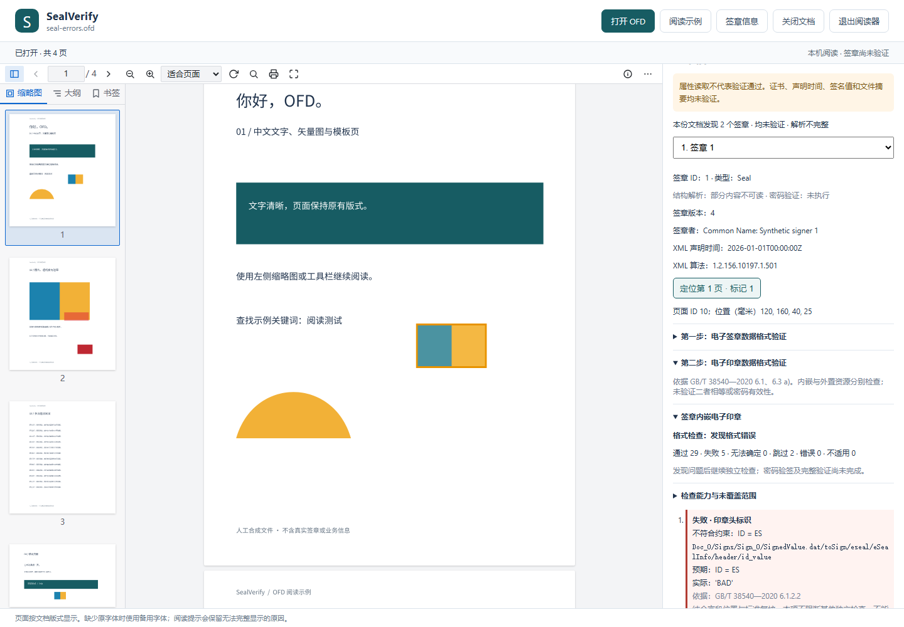

# 电子印章数据格式检查

0.5.0 将 GB/T 38540—2020 第 6.3 a) 的格式检查独立为“第二步：电子印章数据格式验证”。打开 OFD 并选择签章后，分别查看签章内嵌印章与 OFD 外置印章。一个资源损坏不阻断另一个资源或后续签章；格式结果不代表密码验签或印章有效性通过。



## 标准与覆盖

依据已核对的 [GB/T 38540—2020](https://openstd.samr.gov.cn/bzgk/std/newGbInfo?hcno=EBF1360C272E40E7A8B9B32ED0724AB1) 第 6.1 节结构定义及第 6.3 a) 项。第 6.3 b) 制章签名、c) 制章者证书有效性、d) 印章有效期属于后续验证任务。

| 条款 | 自动检查 | 当前边界 |
| --- | --- | --- |
| 6.1.1 | SESeal 单一 DER SEQUENCE、四个必填字段、定义位置与类型、尾随内容 | 不推断其他版本结构；损坏后只保留可安全定位的字段 |
| 6.1.2.1–6.1.2.3 | eSealInfo、印章头、固定 ID `ES`、版本 `4`、厂商标识和印章标识的 IA5String | 不确认标识在外部系统的唯一性或登记真实性 |
| 6.1.2.4 | 印章属性、UTF8String 名称、证书列表类型 1/2、至少一项、Certificate/摘要 CHOICE、三个 GeneralizedTime 的编码和日历 | 不核对名称备案、厂商摘要算法或授权匹配；不使用当前时间判断有效期 |
| 6.1.2.5 | 图像类型、数据、宽高字段编码；PNG/JPG/JPEG/GIF/BMP 类型声明与实际解码一致；SVG 安全 XML 根结构 | 图像可解码不等于完整图像文件规范符合；SVG 图形与业务语义尚未实现。类型示例不是封闭枚举，未知类型记无法确定 |
| 6.1.2.6 | 可选扩展、SEQUENCE OF、OID、OCTET STRING、critical BOOLEAN DEFAULT FALSE | DER 中显式 FALSE 记失败；未知关键扩展的语义需复核 |
| 6.1.3 | 制章者证书的 OCTET STRING、DER Certificate 和必要字段 | 不等于 GB/T 20518 的完整配置约束，不建立信任 |
| 6.1.4–6.1.5 | 算法 OID、SM2/RSA 与主体公钥声明、非空字节对齐 BIT STRING、SM2 DER r/s 或 RSA 原始签名字节 | 不执行签名运算、r/s 数学范围、曲线点、RSA 长度/参数验证；不是 GB/T 33560、35276 的完整符合性检查 |

图像字段的宽高单位为毫米，不与解码后的像素宽高比较；不臆造 ASN.1 未定义的数值范围。制章时间、有效期起止在本项只检查编码；证书摘要类型由厂商定义，不按字符串猜测固定摘要长度。内嵌/外置印章分别检查，不推断二者相同，也不将外置印章替代不可读的内嵌印章。

## 结果与能力说明

- 文件问题进入逐项结果：失败、无法确定、跳过、检查器错误均有说明；通过及不适用折叠展示。
- 通用的未实现约束放在“检查能力与未覆盖范围”，不再生成固定的 `referenced_profiles` 文件问题或伪字段位置。
- `checked_status` 表示已声明检查项的汇总；`coverage.complete` 当前为 `false`。全部已检查项正常时显示“已检查项通过”，`overall_status` 仍为 `incomplete`，表示完整符合性尚未确认。有明确格式错误则为 `failed`。
- OFD 明确没有外置 Seal 声明时，该资源为 `not_applicable`；声明存在但路径/资源不可读，或前置 XML 不可读时，为 `unavailable`，不能当作“未提供”。不影响内嵌印章独立检查。
- 标准流程中的失败仍记录为失败；诊断工具继续独立检查。没有安全字段边界时标明跳过，不猜测后续字节。

## JSON 与命令行

每个签章新增 `seal_format_validation.embedded` 与 `.external`，各自包含计划、检查明细、状态计数、`checked_status`、`overall_status`、`coverage`、`header_version`、`applicability` 和 `stage: seal_data_format`。适用性为 `present` / `unavailable` / `absent`。包级同名字段汇总资源数、状态及已检查项目结论；无签章不产生空集合通过。

原 `format_validation` 保留为第一步签章检查，印章内部明细移到第二步；第一步保留内嵌字段类型和签章/印章版本一致性检查。现有属性字段、`parse_status` 及 `verification` 含义不变。原先按 `toSign/eseal/...` 查找印章检查的调用方应迁移到第二步的 `eSealInfo/...` 等检查 ID。

```powershell
# OFD 中所有内嵌及外置印章；输出仍包含签章与属性供对照
.\.venv\Scripts\python.exe -m sealverify check-seal-format "C:\文档\示例.ofd"
# 独立印章 DER 文件
.\.venv\Scripts\python.exe -m sealverify check-seal-format "C:\文档\Seal.esl" --seal
# 同时考虑两步的完整格式结论
.\.venv\Scripts\python.exe -m sealverify check-format "C:\文档\示例.ofd"
```

先输出全部结果，再返回退出码：`0` 完整格式结论通过，`1` 失败/未完成/不可读，`2` 参数错误。当前完整引用标准约束仍未覆盖，正常可读样例也返回 `1`；请结合 `checked_status` 与逐项结果区分已发现错误和覆盖不足。`inspect` 的退出码继续只反映原属性解析状态。

Python API：`check_seal_format(data)` 返回独立印章报告；`check_signature_formats(data)` 返回 `(第一步报告, 内嵌印章报告)`；`check_signature_format(data)` 仅返回第一步报告。它们位于 `sealverify.inspection.format`，均不执行密码验签。

## 限额与验证

沿用 [第一步格式限额](signature-format.md#限额与验证)。每份印章独立保留最多 512 条明细，超限仍保留省略状态计数；列表尾部损坏或超限时继续检查可定位的前缀。已省略的失败仍影响汇总。修正了长长度 TLV 编码重置节点计数的问题。

图像输入上限 4 MiB、单帧 400 万像素、最多 16 帧、累计 1600 万像素；超限为无法确定。使用 [Pillow 的 verify/load](https://pillow.readthedocs.io/en/stable/reference/Image.html) 实际检查栅格数据，解码不会访问外部资源。SVG 禁用 DTD、实体及外部资源，不进行渲染；因禁止特性而不能解析时说明能力限制，不据此断言文件违反国标。

```powershell
.\.venv\Scripts\python.exe examples/create_signed_demo.py local-data/seal-errors.ofd --seal-errors
.\.venv\Scripts\python.exe -m sealverify view local-data/seal-errors.ofd
```

首个内嵌印章故意含五处错误：印章头、证书列表类型、图像数据、制章者证书和签名编码；两个依赖项跳过。外置印章和第二个签章的印章已检查项正常，第一步的独立字段仍可检查。合成证书与签名没有密码有效性。

单元测试覆盖两类证书列表、多错误/多资源、缺失与未知、列表坏尾部、算法、时间编码、扩展、图像及资源限额；Chromium 验证分步结果、能力说明、阅读与定位。本地两个业务基准继续检查原件哈希、既有属性、完整签名及全部页面；新印章结果使用单独断言，不更新旧清单或公开业务文件。
