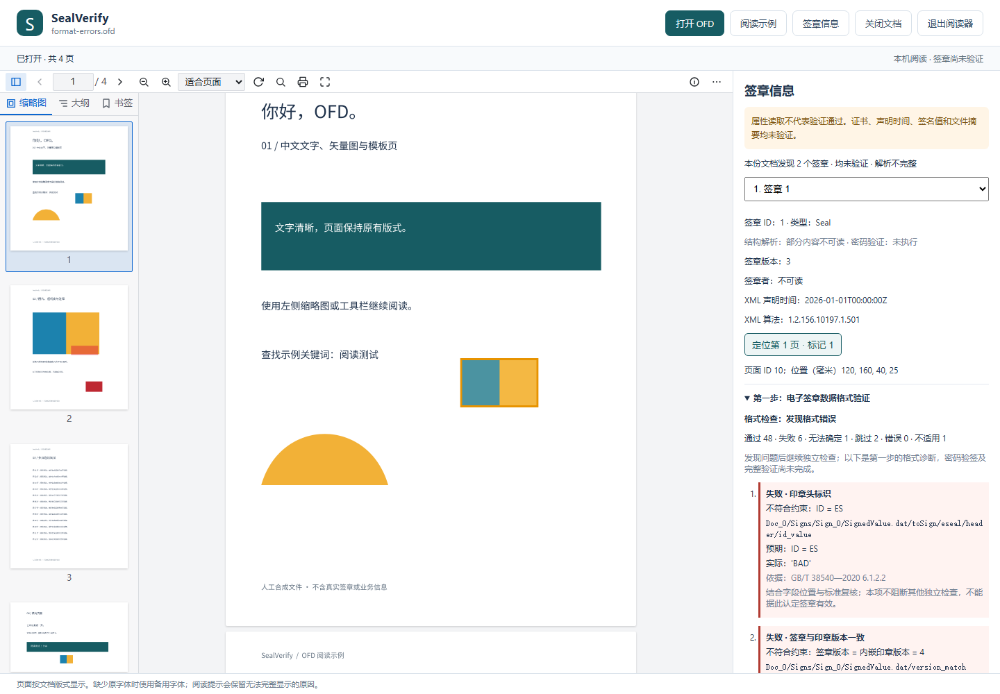

# 电子签章数据格式诊断

版本 0.4.0 在打开 OFD 后自动执行验证流程的第一步，检查 GB/T 38540—2020 版本 4 的电子签章及其内嵌印章。选择签章后展开“第一步：电子签章数据格式验证”，优先查看失败、无法确定、跳过和错误；通过与不适用项目可另行展开。每条结果保留字段位置、说明、预期、可用的实际值、标准条款和复核建议。



## 依据与检查范围

已核对 [GB/T 38540—2020](https://openstd.samr.gov.cn/bzgk/std/newGbInfo?hcno=EBF1360C272E40E7A8B9B32ED0724AB1) 第 6.1、7.1、7.3 a) 节原文。国家标准页面在本次核对时标记为现行。第 7.3 a) 引用的电子印章完整验证还包括密码运算和有效性检查；本步只实现其中的数据格式部分。

| 条款 | 当前自动检查 | 保留的边界 |
| --- | --- | --- |
| 7.1.1 | SES_Signature 容器、字段数/定义位置/类型，时间戳可选且使用 [0] EXPLICIT 标记 | 不猜测其他版本、缺失导致的错位或未知标记 |
| 7.1.2 | TBS_Sign 必填字段、版本与内嵌印章一致且为 4、GeneralizedTime 编码和日历、BIT STRING、IA5String、可选扩展 | 厂商定义的 propertyInfo 需人工确认至少含保护范围，不从字符串推断已覆盖原文 |
| 6.1.1–6.1.2 | 内嵌 SESeal、印章头 ES/版本 4、印章属性、图像字段类型、授权证书列表类型及至少一项、证书/摘要 CHOICE、扩展 DEFAULT 与关键性 | 不验证备案名称、图像实际内容、图像业务规则、有效期或授权关系 |
| 6.1.3、7.1.3 | 证书 OCTET STRING、单一 DER Certificate、必要字段可解码 | 不等于 GB/T 20518 全部配置符合性，不检查信任路径、吊销或有效期 |
| 6.1.4、7.1.4 | OID 编码，支持范围内的 SM2/RSA 签名算法与签名者公钥算法声明；SM2 命名曲线 | 不把证书颁发者签名算法当成主体公钥算法；未知算法/显式或隐式曲线参数需复核，PSS 参数约束未完整检查 |
| 6.1.5、7.1.5 | 字节对齐且非空的签名值、已支持的 SM2 DER r/s 编码；SM2 对应原文杂凑长度为 32 字节 | 不检查 r/s 数学范围、曲线点、RSA 长度与密钥匹配，不重算原文杂凑或执行密码验签 |
| 7.1.6 | 可选时间戳外层标记及 BIT STRING、DER/CMS SignedData、TSTInfo 可读取、签名者信息存在 | 不等于 GB/T 20520 全部符合性，不验证时间戳签名、绑定或可信时间 |

DER 检查包括最短长度、禁止不定长、INTEGER 最短有符号编码、BOOLEAN、OID 子标识、受支持字符串字符集、BIT STRING 填充、UTC 时间编码等。证书和时间戳内部遍历受支持的 DER 类型，未知高编号标签或资源超限记为无法确定。本实现不是通用 ASN.1 符合性认证器。

本步明确列出 `referenced_profiles` 待复核项：GB/T 20518、20520、33560、35276 的完整配置约束及应用语义尚未全部实现。因此即使已检查字段均正常，当前也不会形成完整格式符合性通过结论。外置印章仍作为独立资源展示，本步以签章数据中的内嵌印章为准，未比较二者一致性。

## 错误后继续

标准第 7.3 节描述的流程包含失败后返回并退出。本工具采用诊断模式：保留对应失败判断，继续独立检查，供使用者统一复核；不宣称错误输入符合标准或签章有效。

- 单个字段类型、编码或约束错误，记录失败，继续其他可定位字段。
- 内层结构损坏不阻断外层证书、签名值等独立字段；同一包内其他签章和文档继续检查。
- 无法确定 TLV 边界时只保留安全定位的前缀，后续依赖项标明跳过，不按字节扫描猜测字段。可选字段所在结构不可读时不能报告“未提供”。
- 单项检查器异常记录为错误；内嵌印章检查器异常不阻断外层字段。签章检查的兜底异常保留错误记录，后续签章继续。
- 资源、算法或实现能力不足记为无法确定，未读取或漏报的检查不能算通过。完整流程尚未实现的密码验证步骤不会伪造执行结果。

字段错位时采用标准定义的位置及类型诊断，不猜测同类型字段的真实含义。用户需要结合原始数据和供应方说明判读这些错误。

## JSON 与命令行

```powershell
.\.venv\Scripts\python.exe -m sealverify check-format "C:\文档\示例.ofd"
```

命令在所有可执行的独立检查结束后输出 JSON，再返回退出码；非零退出码不表示首个错误处提前停止。`0` 表示已声明格式计划全部通过；`1` 表示失败、未完成或无法读取；`2` 表示命令参数错误。当前保留必要的人工复核项，正常可读样例也会返回 `1`。`inspect` 仍按原有 `parse_status` 决定退出码，另附相同格式结果。

每个签章新增 `format_validation`，复用 [结果模型](result-model.md) 的计划/结果契约：

| 字段 | 含义 |
| --- | --- |
| `stage`、`standard` | `signature_data_format` 和适用标准版本 |
| `continuation` | `collect_all`，表示问题记录后继续独立检查 |
| `planned_checks`、`checks`、`missing_checks` | 检查计划、逐项状态/位置/依据/建议、未返回项 |
| `overall_status` | `failed` 有格式失败；`incomplete` 有无法确定、跳过、错误或缺项；`passed` 已声明格式计划通过，不代表整体验签 |
| `summary` | 计划数、已返回数、缺项及各状态计数 |
| `omitted_checks` | 达到记录上限后各状态的省略数量；省略部分存在失败时汇总仍为 failed |
| `cryptographic_verification` | 固定 `not_performed` |

包级 `format_validation` 汇总已检查签章数量和状态。无签章或无法读取签章时为 `incomplete`，不会产生空集合通过。现有属性字段及基准保持兼容，格式结果不混入原有属性解析问题。

## 限额与验证

沿用 OFD 容器读取限额；格式检查单签章输入上限 16 MiB，证书 64 KiB、授权列表 64 项、扩展列表 128 项；单层 TLV 最多 20,000 个，证书/时间戳 DER 遍历最多 32 层和 20,000 节点。属性整数读取限制为 64 位、文本 4,096 字节。单签章最多保留 512 条检查明细，超限另报省略计数，检查继续且不能判为完整通过。本机 HTTP 清单总大小仍限制为 32 MiB。

公开测试只使用合成数据。生成可复现的多错误样例：

```powershell
.\.venv\Scripts\python.exe examples/create_signed_demo.py local-data/format-errors.ofd --format-errors
.\.venv\Scripts\python.exe -m sealverify view local-data/format-errors.ofd
.\.venv\Scripts\python.exe -m unittest discover -s tests
cd frontend
npm test
```

首个合成签章有六处格式错误，第二个签章的可检查结构正常，仍保留待复核项；二者都不是真实有效签名。原有带时间戳合成样例故意没有时间戳签名者，格式诊断会报告错误，属性解析仍能展示其可读内容。

两个本地业务附件继续执行原件哈希、既有属性、页面关联、完整签名和浏览器回归；新增格式结果按明确的独立预期检查，不重写原基准清单。原件、清单及报告不上传。
