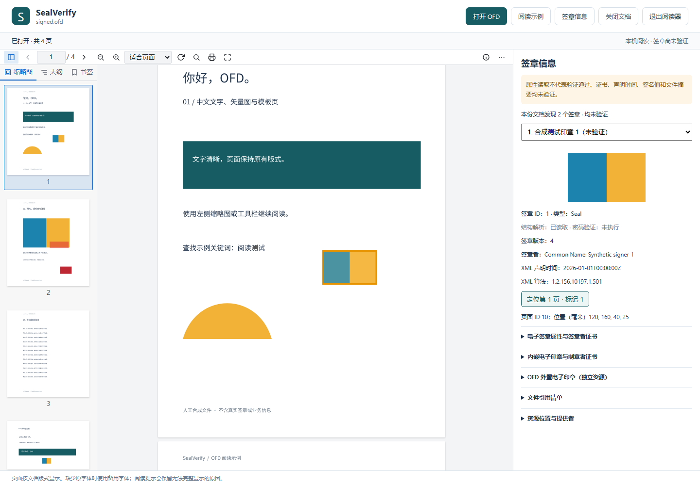

# OFD 签章属性与页面定位

## 使用方式

打开 OFD 后，阅读器将原始包交给本机 Python 解析。发现签章或解析问题时自动显示右侧“签章信息”，也可通过工具栏开关面板。多文档包切换后只显示当前文档的签章。

1. 从“选择签章”选择一项，查看印章预览、签章者、声明时间及算法。
2. 点击“定位第 N 页”，跳转到 `StampAnnot.PageRef` 对应的页面，以黄色框标出 `Boundary`。高亮跟随页面缩放与旋转；它只辅助定位，不改变原件或打印内容。`Clip` 单独展示，不用于推断实际保护范围。
3. 展开电子签章、内嵌印章、外置印章、文件引用清单和资源位置。证书包含主体、颁发者、序列号、有效期、算法、密钥用途和基本约束；数据摘要默认折叠。
4. 查看解析问题中的包内资源路径和字段。单个签章、证书或字段损坏时，继续展示其他独立内容。没有外观标记、页面不明确或矩形不可读时不提供定位。

本阶段所有签章均为 **未验证**。`parsed` 只表示支持范围内的结构已读取，不代表格式全面合规、签名正确、证书可信或时间可信。引用目标存在也不代表摘要一致或覆盖完整。内嵌印章与外置印章分开展示，尚未做一致性检查。

## 命令行与数据契约



```powershell
.\.venv\Scripts\python.exe -m sealverify inspect "C:\文档\示例.ofd"
```

输出 UTF-8 环境下的中文 JSON；默认不写报告文件。退出码 `0` 表示结构读取完成，`1` 表示存在解析问题或无法读取，`2` 表示命令参数错误；任何退出码都不是密码验签结论。

Python 接口为 `sealverify.inspection.inspect_ofd(data: bytes)`。JSON 的 `schema_version` 当前为 `1`：

| 字段 | 含义 |
| --- | --- |
| `verification` | 固定 `not_performed`；与 M1 验证结果模型分离 |
| `parse_status` | `parsed` 已读取、`partial` 有不可读或未支持内容、`error` 未获得文档结构 |
| `source` | 输入长度、SHA-256 和受限十六进制预览 |
| `documents` | 每个 DocBody 的序号、标识、标题、资源路径、页面和签章 |
| `signatures` | 清单标识与独立 key、来源路径、提供者、XML 声明字段、文件引用、外观位置、签名值和外置印章 |
| `signed_value` | 版本 4 的签章、内嵌印章、签章者证书、声明时间、杂凑、原文属性、扩展和可选时间戳 |
| `placements` | 页面 ID、按页面清单换算的 1 起始页码、毫米矩形、页面物理边界；无法唯一定位的值为 null |
| `issues` | 代码、包内路径/字段位置、原因；同时保留全包、文档和单签章问题 |

一般二进制字段仅返回长度、SHA-256 和前 64 字节预览，不导出完整签名或证书 DER。小于等于 1 MiB 且文件头为 PNG/JPEG/GIF 的印章图像可提供 data URL；SVG 等活动格式不内联。属性和证书本身可能含个人信息，JSON 与本地基准清单应作为业务材料保管。

## 结构依据与边界

已直接核对 [GB/T 38540—2020 标准](https://openstd.samr.gov.cn/bzgk/std/newGbInfo?hcno=EBF1360C272E40E7A8B9B32ED0724AB1) 正文的相关 ASN.1 结构：

| 条款 | 本次读取内容 | 未执行内容 |
| --- | --- | --- |
| 6.1.1、6.1.2 | SESeal、ES/版本 4、印章标识/属性、授权证书或证书摘要列表、图像、扩展 | 全面格式符合性、授权关系与业务约束判定 |
| 6.1.3–6.1.5 | 制章者证书、算法 OID、签名值摘要 | 制章签名、证书有效性、路径与吊销验证 |
| 7.1.1、7.1.2 | SES_Signature、TBS_Sign、声明时间、原文杂凑、厂商定义原文属性、扩展 | 签章签名、原文摘要计算及完整保护范围判断 |
| 7.1.3–7.1.6 | 签章者证书、算法、签名值、可选时间戳 CMS/TSTInfo 基本属性 | 时间戳签名、消息印记绑定、证书路径与可信时间判断 |

OFD 清单/引用/外观读取使用 2016 命名空间。相关元素与可选性对照 OFDRW 上游 [SignedInfo](https://github.com/ofdrw/ofdrw/blob/master/ofdrw-core/src/main/java/org/ofdrw/core/signatures/sig/SignedInfo.java)、[References](https://github.com/ofdrw/ofdrw/blob/master/ofdrw-core/src/main/java/org/ofdrw/core/signatures/range/References.java)、[StampAnnot](https://github.com/ofdrw/ofdrw/blob/master/ofdrw-core/src/main/java/org/ofdrw/core/signatures/appearance/StampAnnot.java) 及实际包结构核对，不等于完成 GB/T 33190 的全部符合性认证。XML 中的签名算法和声明时间是可选字段，缺失不直接记为错误。

使用 `DocBody/Signatures` 入口，同时兼容 `Document/Signatures` 扩展；归一化后相同入口只读取一次。以 `/` 开头的资源相对包根目录，其余相对所属 XML；不允许越出包根、访问 URL 或操作系统路径。引用只记录声明，未对任何内容做规范化后验签。

仅支持 GB/T 38540—2020 的版本 4 结构和明确标记的可选扩展/时间戳。旧版 GM/T 0031、其他 SignedValue 容器、隐式标记变体和未知 ASN.1 高编号标签会给出不支持/解析提示，保留可读的 XML、外置印章或数据摘要。X.509 与 CMS 元数据由 [asn1crypto](https://github.com/wbond/asn1crypto) 解码，不依赖证书公钥算法可用于本机密码运算；导入或读取证书不建立信任。

## 输入限额与隐私

解析不解压到磁盘，不修改原件。`defusedxml` 禁用 DTD、实体和外部资源。重名 ZIP 条目不会任选一个读取；重复页面 ID 不猜测页码。

- 包上限 256 MiB，20,000 个条目，声明解压总量 512 MiB。
- 单 XML 2 MiB，最多 20,000 个节点、64 层嵌套；文本/属性最多 4,096 字符。
- 单签名/印章资源 16 MiB，累计实际资源读取量 128 MiB；ASN.1 最多 32 层、20,000 个节点。
- 单证书 64 KiB；每个印章最多 64 个授权证书/摘要，每组最多 128 个扩展。
- 最多 32 份文档、全包 128 个签章、每签章 1,024 条引用。限额导致的省略均记录问题，不能形成完整解析状态。
- 最多记录 500 条问题及一条截断提示；本机 HTTP 响应上限 32 MiB。

浏览器向当前随机路径下的 `inspect` 接口发送所选 OFD 字节，仅连接 `127.0.0.1`；接口检查 Host/Origin、内容类型和长度，不接受本机文件路径。未添加远程上传、持久化报告或业务日志。

## 可复现验证

```powershell
.\.venv\Scripts\python.exe -m unittest discover -s tests -v
.\.venv\Scripts\python.exe examples/create_signed_demo.py local-data/signed.ofd
.\.venv\Scripts\python.exe -m sealverify view local-data/signed.ofd
cd frontend
npm test
cd ..
```

合成签章包含虚构证书、签名值和时间戳，仅测试结构，不能用作有效签名证据。公共 CI 使用合成数据，包含多签章、多文档、坏签章/证书/字段、缺少资源、非法路径、XML 实体及 ASN.1 限额。

本地业务回归使用忽略目录中的 `local-data/local-samples.json` 清单：记录原件相对路径、SHA-256 和已人工核对的预期属性。执行 `.\.venv\Scripts\python.exe tools/check_local_samples.py` 与 `cd frontend; npm run test:local`。显式本地回归在缺少原件/清单或内容改变时失败，不静默跳过、不自动更新基准；业务文件、清单及测试结果不上传。浏览器本地测试禁用截图、录像和 trace，检查所有页面绘制、签章选择、证书属性、页面关联、无远程请求和原件不变。
